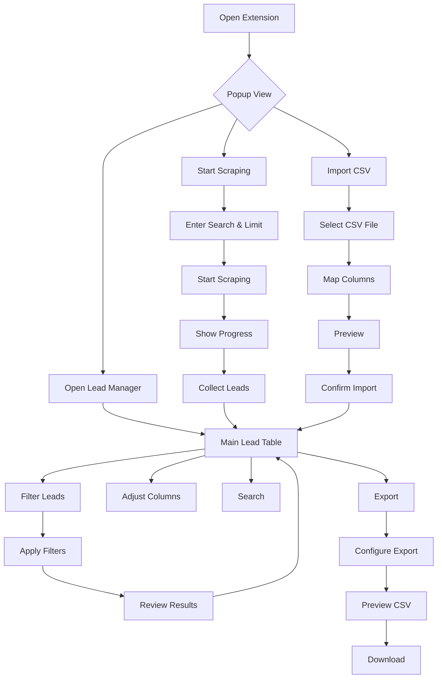

# Design Document

## Design Philosophy

Create a professional, clean interface for business lead research:
- Efficient, focused layouts that prioritize data visualization
- Clear, intuitive controls for searching and filtering
- Professional visual language for business users
- Consistent, accessible design system

## Color Palette

```
Primary: #1a73e8 (Google Blue)
Primary Hover: #1857ca (Darker Blue)
Secondary: #5f6368 (Google Gray)
Success: #34a853 (Green)
Warning: #fbbc04 (Yellow)
Error: #ea4335 (Red)
Background: #f8f9fa (Light Gray)
Surface: #ffffff (White)
Border: #dadce0 (Medium Gray)
Text Primary: #202124 (Dark)
Text Secondary: #5f6368 (Gray)
Text Muted: #9aa0a6 (Light Gray)
```

## Typography

- Font family: Google Sans, system UI (`-apple-system`, `BlinkMacSystemFont`, `Segoe UI`, `Roboto`, `sans-serif`)
- Base size: 14px
- Line height: 1.4
- Weights: 400 (normal), 500 (medium), 600 (semibold)

## Screen Layouts

### 1. Popup (Quick Actions)

```
┌─────────────────────────┐
│  Google Maps Scraper    │
├─────────────────────────┤
│  [Open Lead Manager]    │
│                         │
│  ┌───────────────────┐  │
│  │ Scrap Google Maps │  │
│  └───────────────────┘  │
│                         │
│  Search: "[clear]"      │
│  Limit: [10-10000]      │
│  [Start Scraping]       │
│                         │
└─────────────────────────┘
```

**Dimensions**: 360px width, auto-height
**Interactions**:
- Click "Open Lead Manager" to show main view
- Click "Scrap Google Maps" to start scraping process
- Enter search query and set record limit
- Click "Start Scraping" to begin collection

### 2. Main View - Lead Table

```
┌────────────────────────────────────────────────────────────┐
│  Google Maps Scraper                                [⚙]  │
├────────────────────────────────────────────────────────────┤
│  [Search...]  [Filters ▼]  [Columns ▼]  [Export]  [Import] │
├────────────────────────────────────────────────────────────┤
│  ┌─ All (47) ─┬─ Website ─┬─ Phone ─┬─ Email ─┬─ Social ─┐
│  │            │           │         │         │         │
│  ├─────────────────────────────────────────────────────────┤
│  │                                                         │
│  │  Business Name          Category    Phone      Website  │
│  │  ─────────────────────────────────────────────────────  │
│  │  Acme Corp              Retail      555-1234   website  │
│  │  Joe's Bakery           Food        555-5678   website  │
│  │  Tech Solutions         Services    ─         ─         │
│  │  ...                                                     │
│  │                                                         │
│  └─────────────────────────────────────────────────────────┘
│                                                         47 leads
└────────────────────────────────────────────────────────────┘
```

**Dimensions**: Minimum 800px width, 600px height
**Header Actions**:
- **Search**: Text search across visible columns
- **Filters**: Dropdown with filter options
- **Columns**: Toggle visible columns
- **Export**: Open export dialog
- **Import**: Open import dialog

### 3. Filter Dropdown

```
┌──────────────────────────────────────────┐
│  Filters                         [Apply] │
├──────────────────────────────────────────┤
│  Data Presence                           │
│  ┌────────────────────────────────────┐  │
│  │ ☐ Website present    ☐ Website abs │  │
│  │ ☐ Phone present      ☐ Phone abs   │  │
│  │ ☐ Email present      ☐ Email abs   │  │
│  │ ☐ Social present     ☐ Social abs  │  │
│  └────────────────────────────────────┘  │
│                                         │
│  Source: [All ▼]                        │
│  Category: [All ▼]                      │
│  Tags: [Select tags...]                 │
│                                         │
│  [Clear Filters]                        │
└──────────────────────────────────────────┘
```

### 4. Column Visibility Panel

```
┌────────────────────────────────────┐
│  Visible Columns             [✓]  │
├────────────────────────────────────┤
│  ☐ [✓] Business Name               │
│  ☐ [✓] Category                    │
│  ☐ [✓] Phone                       │
│  ☐ [✓] Website                     │
│  ☐ [ ] Email                       │
│  ☐ [ ] Street Address              │
│  ☐ [ ] City                        │
│  ☐ [ ] Region                      │
│  ☐ [ ] Postal Code                 │
│  ☐ [ ] Country                     │
│  ☐ [ ] Social Profiles             │
│  ☐ [ ] Source                      │
│  ☐ [ ] Collected At                │
│  ☐ [ ] Email Status                │
│  ☐ [ ] Social Status               │
│  ☐ [ ] Tags                        │
│  ☐ [ ] User Notes                  │
└────────────────────────────────────┘
```

### 5. Export Dialog

```
┌────────────────────────────────────────────────────────────┐
│  Export Leads                                        [✕] │
├────────────────────────────────────────────────────────────┤
│                                                            │
│  Preview: 15 leads (filtered from 47 total)               │
│  File: google_maps_leads_2024-01-15.csv                   │
│                                                            │
│  ┌──────────────────────────────────────────────────────┐  │
│  │ Filter Options                                       │  │
│  │                                                      │  │
│  │  Website: (•) Include all  ○ With website  ○ No web │  │
│  │  Phone:   (•) Include all  ○ With phone    ○ No phone│  │
│  │  Email:   (•) Include all  ○ With email    ○ No email│  │
│  │  Social:  (•) Include all  ○ With social   ○ No social│  │
│  │                                                      │  │
│  │  Sort: (•) Original order                          │  │
│  │         ○ Websites first                            │  │
│  │         ○ Websites last                             │  │
│  │                                                      │  │
│  └──────────────────────────────────────────────────────┘  │
│                                                            │
│  ┌──────────────────────────────────────────────────────┐  │
│  │ Preview (first 5 rows)                               │  │
│  │ ┌──────────────────────────────────────────────────┐ │  │
│  │ │ Business Name | Category | Phone | Website       │ │  │
│  │ │ ──────────────────────────────────────────────── │ │  │
│  │ │ Acme Corp     | Retail    | 555… | yes           │ │  │
│  │ │ Joe's Bakery  | Food      | 555… | yes           │ │  │
│  │ │ Tech Solutions| Services  | ─    | ─             │ │  │
│  │ │ ...                                              │ │  │
│  │ └──────────────────────────────────────────────────┘ │  │
│  └──────────────────────────────────────────────────────┘  │
│                                                            │
│                           [Cancel]  [Download CSV]         │
└────────────────────────────────────────────────────────────┘
```

### 6. Import Dialog

```
┌────────────────────────────────────────────────────────────┐
│  Import CSV                                           [✕] │
├────────────────────────────────────────────────────────────┤
│                                                            │
│  Step 1: Select File                                      │
│  ┌──────────────────────────────────────────────────────┐  │
│  │  [Choose File]  google_maps_data.csv           [✓]  │  │
│  └──────────────────────────────────────────────────────┘  │
│                                                            │
│  Step 2: Map Columns                                       │
│  ┌──────────────────────────────────────────────────────┐  │
│  │  CSV Column          →  Lead Field                   │  │
│  │  ─────────────────────────────────────────────────   │  │
│  │  Company Name        →  Business Name          [▼]   │  │
│  │  Phone Number        →  Phone                   [▼]   │  │
│  │  Email Address       →  Email                   [▼]   │  │
│  │  Website             →  Website                 [▼]   │  │
│  │  Category            →  Category                [▼]   │  │
│  │  Address             →  Street Address          [▼]   │  │
│  │  City                →  City                    [▼]   │  │
│  │  State               →  Region                  [▼]   │  │
│  │  ZIP                 →  Postal Code             [▼]   │  │
│  └──────────────────────────────────────────────────────┘  │
│                                                            │
│  Validation: 0 errors, 3 warnings, 2 rows will be skipped │
│  [Preview Import]                                          │
│                                                            │
│                           [Cancel]  [Import 25 leads]      │
└────────────────────────────────────────────────────────────┘
```

## Component States

### Table States
| State | Description |
|-------|-------------|
| **Empty** | No leads collected yet. Show "Get started" message with search/import options |
| **Loading** | Fetching leads from storage or scraping. Show spinner |
| **Error** | Failed to load leads or scrape. Show error message with retry button |
| **No Results** | Filters applied but no matching leads. Show clear filters button |
| **Populated** | Leads displayed in table with all UI controls |

### Filter States
| State | Indicator |
|-------|-----------|
| **No filters** | Filters button shows neutral color |
| **Active filters** | Button highlights, badge shows count |
| **Combination** | Clear All button available |

### Export States
| State | Description |
|-------|-------------|
| **Preview** | Shows filtered count, filename preview, sample rows |
| **Generating** | Building CSV, show progress |
| **Ready** | CSV ready, show download button |
| **Error** | Export failed, show error with retry |

## User Flow Diagram



## Accessibility Requirements

- All interactive elements have visible focus state
- Buttons and links have descriptive labels
- Tables have proper header associations
- Dialogs trap focus and close on Escape
- Color is not the only indicator of state
- Minimum touch target size: 44x44px
- Keyboard navigation through all interactive elements
- ARIA labels where visual context is insufficient

## Responsive Behavior

- **Small (<600px)**: Show mobile-optimized layout, potentially scrolling table
- **Medium (600-800px)**: Condensed table with horizontal scroll
- **Large (800px+)**: Full table with all controls visible

## Future Design Considerations

- Dark mode support
- Additional export formats (JSON, Excel)
- Bulk edit actions
- Source management interface
- Advanced filter conditions

## CSS Variables (for theming)

```css
:root {
  --primary: #1a73e8;
  --primary-hover: #1857ca;
  --secondary: #5f6368;
  --success: #34a853;
  --warning: #fbbc04;
  --error: #ea4335;
  --background: #f8f9fa;
  --surface: #ffffff;
  --border: #dadce0;
  --text-primary: #202124;
  --text-secondary: #5f6368;
  --text-muted: #9aa0a6;
}
```